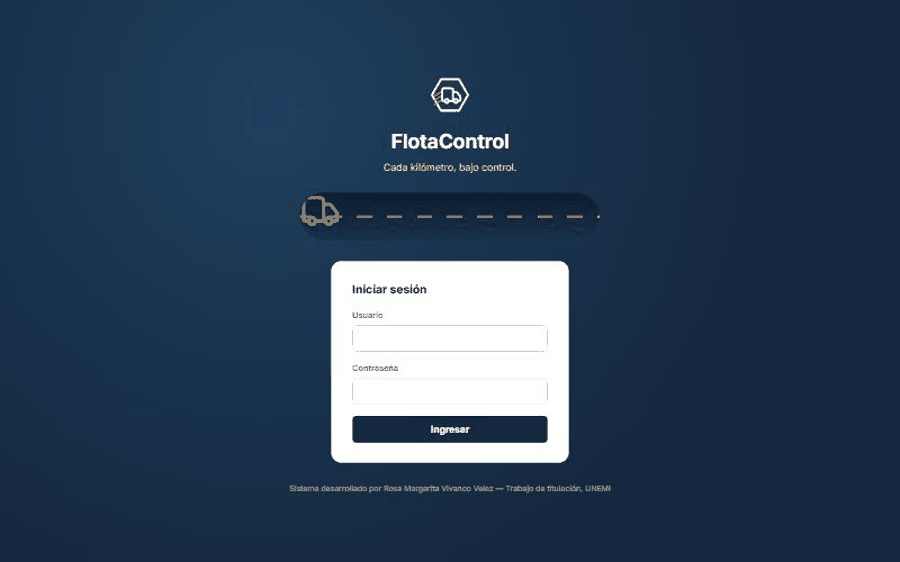
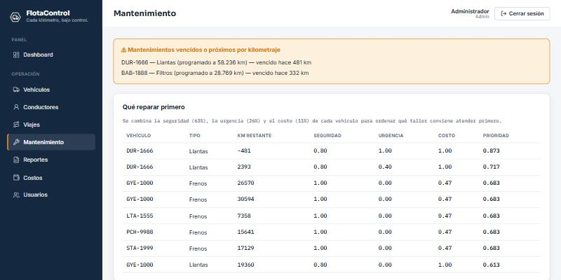
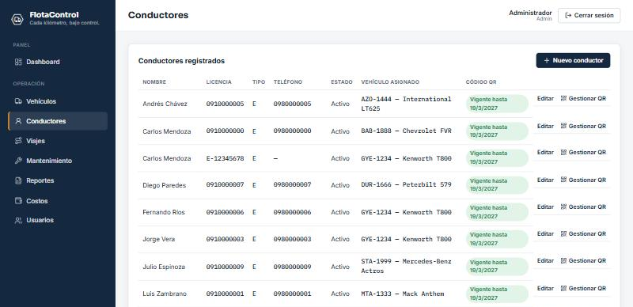

# FlotaControl — control de costos y mantenimiento de una flota de carga pesada

**Sistema web con arquitectura de microservicios para el control de costos operativos y mantenimiento de una flota de
transporte de carga pesada, con priorización de mantenimiento mediante AHP.**

Trabajo de titulación de **Rosa Margarita Vivanco Vélez**, Ingeniería en Tecnologías de la Información, Universidad
Estatal de Milagro (UNEMI). Docentes: M.Sc. Mirella Azucena Peralta Correa y M.Sc. María Gabriela Espinoza Bravo.



| | |
|---|---|
| **Versión** | `v1.1-avance2` (Avance 2 del trabajo de titulación) |
| **Pruebas** | 908 automatizadas (907 aprobadas, 1 omitida por diseño); cobertura 80 % |
| **Rendimiento** | Tablero con p95 de 1,19 s con 10 usuarios a la vez (meta: 2 s) |
| **Tecnologías** | Python 3.12 · FastAPI · SQLAlchemy · PostgreSQL 16 · React + TypeScript · Nginx · Docker |
| **Datos** | Todas las capturas y la base de prueba usan **datos ficticios** |

## Video de demostración

El recorrido animado de arriba muestra las pantallas principales. El video con la demostración completa (inicio de sesión, tablero de costos, registro de un viaje, despacho por QR desde el celular y ranking de mantenimientos) se publica con el Avance 3.

---

## Contenido
1. [El problema](#1-el-problema)
2. [Qué hace el sistema](#2-qué-hace-el-sistema)
3. [Capturas](#3-capturas)
4. [Arquitectura](#4-arquitectura)
5. [Diseño: UML y modelo de datos](#5-diseño-uml-y-modelo-de-datos)
6. [Priorización del mantenimiento con AHP](#6-priorización-del-mantenimiento-con-ahp)
7. [Pruebas y calidad](#7-pruebas-y-calidad)
8. [Cómo ejecutarlo](#8-cómo-ejecutarlo)
9. [Estructura del repositorio](#9-estructura-del-repositorio)
10. [Alcance y trabajo futuro](#10-alcance-y-trabajo-futuro)

---

## 1. El problema

En una pequeña empresa de transporte de carga pesada, los gastos de cada viaje (combustible, peajes, alimentación) y el
mantenimiento de los camiones se registran a mano, en comprobantes dispersos y a cargo de una sola persona. Por eso:

- no se conoce el **costo real** de cada camión ni por kilómetro;
- el mantenimiento es **reactivo**: se repara cuando el camión ya falló;
- los registros se duplican o no cuadran;
- no hay indicadores para decidir;
- la información depende de una sola persona.

## 2. Qué hace el sistema

| Módulo | Qué resuelve | Requisitos |
|---|---|---|
| Usuarios y roles | Inicio de sesión con token (JWT), roles Administrador y Operador, bloqueo tras intentos fallidos | RF-01 a RF-03 |
| Flota | Vehículos y conductores, con licencia y vehículo asignado | RF-04, RF-05 |
| Viajes y gastos | Viajes con kilometraje; gastos de combustible, peajes y alimentación por viaje | RF-06 a RF-10, RF-14 |
| Despacho por QR | El conductor registra su viaje **desde su celular** escaneando una credencial QR personal, revocable y con vigencia de 180 días, sin usuario ni contraseña | RF-18 |
| Costos | Costo variable y total **Ct = Cv + Cf** (costos fijos del vehículo y de personal), costo por kilómetro en ocho categorías, consumo, utilización, con y sin IVA | RF-15, RF-16, RF-21 |
| Mantenimiento | Registro por tipo; **alertas** por kilometraje (vencido, próximo) | RF-11 a RF-13 |
| Priorización | **Ranking AHP** de los mantenimientos pendientes según seguridad, urgencia y costo | RF-19, RF-20 |
| Reportes | Exportación a Excel y PDF | RF-17 |

Son 21 requisitos funcionales, cada uno con su criterio de aceptación y las pruebas que lo verifican, y 11 no
funcionales según ISO/IEC 25010:2023.

## 3. Capturas

| Inicio de sesión | Tablero de costos (Ct = Cv + Cf) |
|---|---|
|  |  |
| **Alertas y ranking AHP de mantenimientos** | **Conductores con credencial QR vigente** |
|  |  |

## 4. Arquitectura

Son tres microservicios de grano grueso detrás de un gateway. Cada servicio es dueño de su propio esquema de base de datos.


| Componente | Responsabilidad |
|---|---|
| `auth-service` | Usuarios, roles, contraseñas con hash, JWT y bloqueo temporal |
| `fleet-core-service` | Vehículos, conductores, viajes, gastos, mantenimiento, costos fijos y despacho QR |
| `reporting-service` | Tablero, indicadores de costo, ranking AHP y reportes; no tiene base propia, consulta a `fleet-core-service` con el token del usuario |
| `gateway` (Nginx) | Punto único de entrada: rutas `/api/auth`, `/api/fleet`, `/api/reports`, límite de solicitudes y HTTPS en producción |
| `postgres` | Una instancia con dos esquemas, `auth` y `fleet`, cada uno con su propio rol de base de datos |
| `frontend` | Aplicación de una sola página (React + TypeScript + Vite), con el panel web y el portal móvil del conductor |

**Por qué microservicios.** Se compararon tres estilos con una matriz ponderada:

| Estilo | Puntaje |
|---|---|
| Microservicios | 3,95 |
| Monolito modular | 3,60 |
| Monolito en capas | 3,35 |

Ganaron por el aislamiento de los datos personales y el despliegue independiente de cada parte, **no por rendimiento**:
en rendimiento y en costo de operación gana el monolito.

**Despliegue**

| Producción local con HTTPS (verificado) | Cloud Run (propuesto, no desplegado) |
|---|---|
|  |  |

## 5. Diseño: UML y modelo de datos

<details open>
<summary><b>Casos de uso</b></summary>


</details>

<details>
<summary><b>Secuencia: ranking AHP de mantenimientos</b></summary>

El navegador pide el ranking al gateway. `reporting-service` valida el token y el rol, pide a `fleet-core` los vehículos,
la política de alertas, los costos históricos y los mantenimientos pendientes, y calcula el puntaje AHP.


</details>

<details>
<summary><b>Secuencia: emisión y despacho por código QR</b></summary>

El administrador emite la credencial; el conductor la escanea y el token viaja en la cabecera `X-Despacho-Token`. El
servidor compara el resumen (hash) en tiempo constante y verifica la vigencia.


</details>

<details>
<summary><b>Secuencia: cierre del viaje y alerta de mantenimiento</b></summary>


</details>

<details>
<summary><b>Colaboración, estados, actividades y flujo de trabajo</b></summary>


</details>

<details>
<summary><b>Modelo entidad-relación (9 tablas, esquemas auth y fleet)</b></summary>


</details>

## 6. Priorización del mantenimiento con AHP

El ranking combina tres criterios con pesos del Proceso de Análisis Jerárquico (Saaty):

| Criterio | Peso |
|---|---|
| Seguridad (criticidad del tipo de mantenimiento) | 0,633 |
| Urgencia por kilometraje | 0,260 |
| Costo estimado | 0,106 |

- **Consistencia:** razón de consistencia CR = 0,0334, menor que 0,10. **El servicio no arranca** si la matriz
  configurada es inconsistente (CR ≥ 0,10).
- **Estabilidad:** el orden se mantiene con cambios de ±30 % en los pesos (τ de Kendall mínima de 0,935).
- **Matriz provisional:** la matriz actual la definió la autora y se reemplazará con los juicios de 3 a 5 expertos.
  Los pesos están en `services/reporting-service/app/dashboards/ahp_config.json`, no en el código.

## 7. Pruebas y calidad

| Servicio | Pruebas | Aprobadas | Omitidas |
|---|---|---|---|
| auth-service | 89 | 89 | 0 |
| fleet-core-service | 546 | 545 | 1 |
| reporting-service | 273 | 273 | 0 |
| **Total** | **908** | **907** | **1** |

- **Pruebas de integración:** envían peticiones HTTP reales a través del gateway, con autenticación y roles.
- **Prueba omitida:** comprueba el límite de intentos del QR. Bloquea el gateway durante un minuto, así que solo corre
  con `RUN_RATE_LIMIT_TESTS=1`.
- **Cobertura:** 80 % en total y entre 69 y 94 % por servicio (meta: 60 %).
- **Prueba de carga (k6):** el tablero responde con un p95 de 1,19 s con 10 usuarios (meta: menos de 2 s).
- **Benchmark con un millón de viajes:** las consultas por vehículo o por viaje son de 6 a 10 veces más rápidas con índices.
- **Integración continua:** GitHub Actions corre las pruebas en cada cambio (`.github/workflows/ci.yml`).

## 8. Cómo ejecutarlo

Requisitos: **Git** y **Docker Desktop** (no hace falta instalar Python, Node.js ni PostgreSQL).

```bash
git clone https://github.com/rvivancov-del/control_flota.git
cd control_flota
docker compose up --build
```

Para trabajar con la base de prueba ficticia (12 vehículos, 13 conductores, 640 viajes), sigue `scripts/README.md` (`seed_demo.py` y carga de `scripts/seed/pilot_dataset.sql`).

Detalle:


1. `docker-compose.yml` lee directamente los `.env.example` de cada
   servicio (valores de prueba locales, sin secretos reales — por eso
   están versionados). Antes de un despliegue real, crea un `.env` propio
   por servicio y cambia la referencia `env_file`.
2. Desde esta carpeta:

   ```bash
   docker compose up --build
   ```

3. Servicios disponibles:
   - Frontend: http://localhost:5173
   - API (gateway): http://localhost:8080/api/auth/... · /api/fleet/... · /api/reports/...
   - PostgreSQL: no se publica en el equipo (solo lo ven los servicios). Consola: `docker compose exec postgres psql -U flota -d flota_db`
   - Usuario inicial: `admin` / `Admin1234` (creado por `auth-service/app/seed.py`
     en el primer arranque — cámbialo antes de cualquier despliegue real).
   - Los `.env.example` traen `APP_ENV=development`. Sin esa variable (o con otro valor) los servicios
     **no arrancan** con la clave JWT ni la contraseña de base de datos por defecto, y el sembrado exige
     una clave inicial propia para el administrador y le pide cambiarla al primer ingreso (RNF-02).

#### Generar una migración nueva (al cambiar un modelo)

```bash
docker compose run --rm --no-deps -v "$(pwd)/services/<servicio>:/app" <servicio> \
  alembic revision --autogenerate -m "descripción del cambio"
```

Revisa siempre el archivo generado en `migrations/versions/` antes de
aplicarlo. `docker compose up --build` lo aplica automáticamente al iniciar
(`alembic upgrade head` corre antes de `uvicorn`, ver el `CMD` del Dockerfile).

#### Correr las pruebas de un servicio

```bash
docker compose exec <servicio> sh -c "pip install -q -r requirements-test.txt && pytest -q"
```

### Solución de problemas

#### "404 Not Found" en cualquier ruta `/api/...` después de reconstruir un servicio

El `gateway` (nginx) resuelve el nombre de cada servicio (`auth-service`,
`fleet-core-service`, `reporting-service`) **una sola vez**, al arrancar, y
cachea la IP interna de Docker que le corresponde en ese momento. Si luego
reconstruyes o recreas SOLO uno de esos servicios
(`docker compose up --build auth-service`, por ejemplo) sin tocar el
gateway, el contenedor nuevo recibe una IP distinta y nginx se queda
apuntando a la vieja. Solución:

```bash
docker compose restart gateway
```

Corre ese comando cada vez que reconstruyas un servicio por separado.
`docker compose up --build` (todos juntos) no tiene este problema porque el
gateway también se recrea en la misma pasada. Es una limitación exclusiva
del entorno local — no existe en producción (Cloud Run resuelve por
HTTPS/DNS público, no por IP interna de una red Docker).

#### El conductor abre el QR y el navegador de su celular no conecta

El código QR codifica el `window.location.origin` de quien lo generó. Si el
panel de administración se abrió en `localhost`, el QR apunta a
`localhost:5173` — que en el celular del conductor se refiere al propio
celular, no a la computadora del administrador. Para pruebas en la misma
red local, abre el panel desde la IP de red de la computadora (por ejemplo
`http://192.168.1.37:5173`) antes de generar el QR. Para que funcione desde
cualquier lugar con internet (el caso de uso real), hace falta el
despliegue a la nube — ver `10_MANUALES_USUARIO_Y_TECNICO/manual_tecnico.docx`.


## 9. Estructura del repositorio

```
control_flota/
├── docker-compose.yml          # entorno local completo
├── docker-compose.prod.yml     # producción local con HTTPS
├── infra/
│   ├── nginx/                  # gateway
│   └── postgres/               # un rol por servicio, dueño de su esquema
├── services/
│   ├── auth-service/           # usuarios, roles y JWT
│   ├── fleet-core-service/     # flota, viajes, gastos, mantenimiento, costos y QR
│   └── reporting-service/      # tablero, costos, AHP y reportes
├── frontend/                   # React + TypeScript (panel y portal del conductor)
├── scripts/                    # datos de prueba, informes, benchmark y prueba de carga
└── docs/                       # capturas, diagramas y recorrido animado de este README
```

Cada servicio tiene su propio `README.md`, con sus endpoints y decisiones de diseño.

## 10. Alcance y trabajo futuro

- **Fuera del alcance:**
  - GPS en tiempo real;
  - notificaciones por SMS o WhatsApp;
  - control de vencimiento de documentos (SOAT, matrícula);
  - facturación electrónica;
  - mantenimiento basado en sensores.
- **Siguiente etapa:**
  - validar los costos con un mes de datos reales de la empresa caso;
  - reemplazar la matriz AHP por los juicios de 3 a 5 expertos;
  - validar con usuarios (tareas cronometradas y cuestionario SUS);
  - desplegar en Cloud Run.

---

© 2026 Rosa Margarita Vivanco Vélez — Universidad Estatal de Milagro. Trabajo de titulación con fines académicos.
